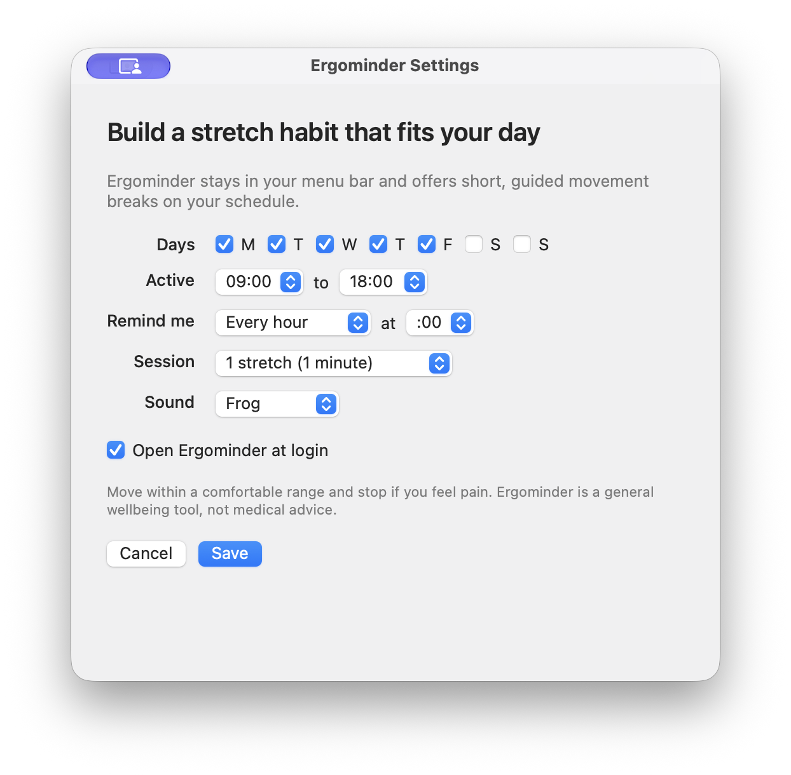

# Ergominder

Ergominder is a small macOS menu-bar app that reminds you to take short, guided stretch breaks. You choose the days, hours, frequency, sound, and number of stretches. Everything stays on your Mac.



## Download

Download the universal macOS disk image and its matching `SHA256SUMS.txt` file from the repository's [Releases page](https://github.com/cipshadow/ergominder/releases). Use the assets from the same release.

Requirements: macOS 13 Ventura or later on an Apple Silicon or Intel Mac. Each release contains one universal app, so there is no separate download for your processor.

## Install

1. Open the downloaded Ergominder disk image.
2. Drag `Ergominder.app` to the Applications folder shortcut in the disk-image window.
3. Eject the disk image.
4. Open your Applications folder.
5. Control-click `Ergominder`, choose **Open**, then choose **Open** again in the warning. You need to do this once for each new downloaded version.
6. Choose your reminder schedule and click **Save**.

If **Open** is unavailable, try opening Ergominder normally once, then go to **System Settings > Privacy & Security** and choose **Open Anyway**. Do not disable Gatekeeper. Apple explains this one-app exception in [Safely open apps on your Mac](https://support.apple.com/102445).

Ergominder is distributed without an Apple Developer ID certificate and is not notarized by Apple, so macOS shows the warning above. Download it only from this repository's Releases page.

## Use

After installation, look for the stretching figure in the menu bar. Its menu lets you:

- start a stretch session now;
- pause or resume reminders;
- see the next reminder;
- view local session counts;
- change your schedule;
- quit the app.

Enable **Start Ergominder at login** in Settings if you want it to launch automatically.

## Verify the download

Each release includes `SHA256SUMS.txt`. To check that the disk image downloaded without changing, place both files in the same folder and run:

```sh
cd /path/to/the/download/folder
shasum -a 256 -c SHA256SUMS.txt
```

The line for the downloaded disk image should end with `OK`. The checksum detects a changed or incomplete download; it does not replace Apple's Developer ID and notarization checks.

## Privacy

Ergominder has no account, analytics, advertising, or network code. It stores your schedule, pause state, and simple yes/not-now/away counts in macOS preferences under `com.cipblujdea.ergominder`.

## Uninstall

1. Choose **Quit Ergominder** from its menu-bar menu.
2. In **System Settings > General > Login Items**, remove Ergominder if it appears.
3. Move `/Applications/Ergominder.app` to the Trash.

To remove its settings and local counts too, run:

```sh
defaults delete com.cipblujdea.ergominder
```

## Source and license

Ergominder is proprietary software. This public repository contains release files, checksums, screenshots, and documentation only. The source code is not published. See [LICENSE](LICENSE).
