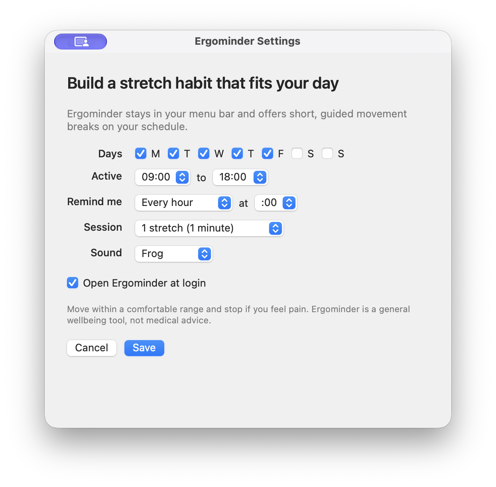

# Ergominder

Ergominder is a macOS menu-bar app that reminds you to take short, guided stretch breaks. You choose the days, hours, frequency, sound, and number of stretches. Everything stays on your Mac.

Requirements: macOS 13 Ventura or later, on an Apple Silicon or Intel Mac. Each release is one universal app, so there is no separate download for your processor.



## Installing

1. Download the latest release from the [GitHub Releases page](https://github.com/cipshadow/ergominder/releases). Use the disk image (the `.dmg` file) from that release. The matching `SHA256SUMS.txt` file is there too if you want to check the download later.
2. Open the disk image and drag `Ergominder.app` to the Applications folder. Eject the disk image when that is done.
3. Open Ergominder from your Applications folder.

The first time you open it, macOS says it can't verify the developer and will not launch the app. That message is expected. Allow Ergominder once for each new downloaded version. Do not turn off Gatekeeper.

**macOS 15 Sequoia and later**

1. Open **System Settings**.
2. Go to **Privacy & Security**.
3. Scroll down and click **Open Anyway**.
4. Confirm that you want to open Ergominder.

The **Open Anyway** button shows up after macOS has blocked the app once. If you do not see it, try opening Ergominder from Applications, then return to **Privacy & Security**.

**Older macOS**

Right-click `Ergominder` in your Applications folder and choose **Open**, then choose **Open** again in the warning.

**Terminal**

You can also clear the quarantine flag macOS puts on downloaded apps, then open Ergominder as usual:

```sh
xattr -dr com.apple.quarantine /Applications/Ergominder.app
```

macOS shows the warning because Ergominder is a free app built by an independent developer, without a paid Apple signing certificate, and it is not notarized. Download it only from this repository's Releases page. Apple describes this one-app exception in [Safely open apps on your Mac](https://support.apple.com/102445).

When the app opens, choose your reminder schedule and click **Save**.

## Use

After installation, look for the stretching figure in the menu bar. Its menu lets you:

- start a stretch session now;
- pause or resume reminders;
- see the next reminder;
- view local session counts;
- change your schedule;
- quit the app.

Enable **Start Ergominder at login** in Settings if you want it to launch automatically.

## Verify the download

Each release includes `SHA256SUMS.txt`. To check that the disk image downloaded without changing, place both files in the same folder and run:

```sh
cd /path/to/the/download/folder
shasum -a 256 -c SHA256SUMS.txt
```

The line for the downloaded disk image should end with `OK`. The checksum detects a changed or incomplete download; it does not replace Apple's Developer ID and notarization checks.

## Privacy

Ergominder has no account, analytics, advertising, or network code. It stores your schedule, pause state, and simple yes/not-now/away counts in macOS preferences under `com.cipblujdea.ergominder`.

## Uninstall

1. Choose **Quit Ergominder** from its menu-bar menu.
2. In **System Settings > General > Login Items**, remove Ergominder if it appears.
3. Move `/Applications/Ergominder.app` to the Trash.

To remove its settings and local counts too, run:

```sh
defaults delete com.cipblujdea.ergominder
```

## Source and license

Ergominder is proprietary software. This public repository contains release files, checksums, screenshots, and documentation only. The source code is not published. See [LICENSE](LICENSE).
